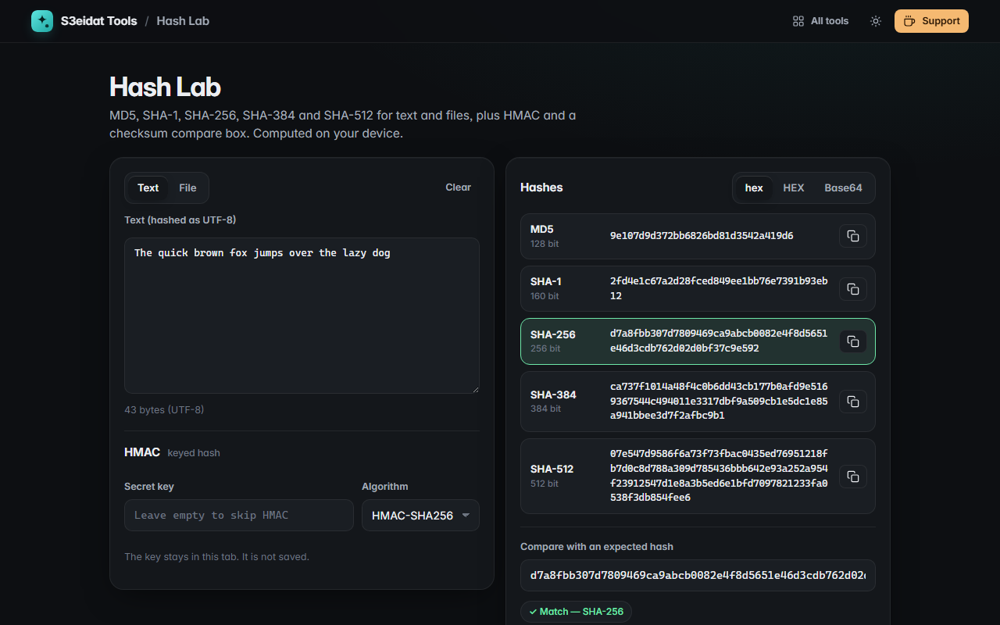

# Hash Lab

> MD5, SHA-1, SHA-256, SHA-384 and SHA-512 for text and files, with HMAC and checksum verification. Free, private, and it runs entirely in your browser.

### ▶ [Open Hash Lab](https://s3eidat.github.io/hash-lab/)



## Features

- **Live hashes** of text as you type (UTF-8): MD5, SHA-1, SHA-256, SHA-384, SHA-512
- **Hash files** up to 512 MB by dropping them in, with timing
- **Compare box**: paste the checksum from a download page and see which hash matches.
  Accepts hex in any case, with spaces or colons, `SHA256 (file) = …` lines, or Base64
- **HMAC** (SHA-256, SHA-384, SHA-512, SHA-1) with a secret key that is never saved
- Output as lowercase hex, UPPERCASE hex or Base64; copy one, copy all, or download a `.txt`

SHA hashes use the browser's built-in Web Crypto (`crypto.subtle`). MD5 is not in Web Crypto,
so Hash Lab ships its own RFC 1321 implementation, checked against the official test vectors on every load.
MD5 and SHA-1 are fine for checksums but broken for security; prefer SHA-256 or better.

## Privacy

Your text, files and keys never leave your device. There is no server, no account, no analytics.
The page ships with a strict Content-Security-Policy (`connect-src 'self'`), so the browser
itself blocks any attempt to send data anywhere.

## Run it yourself

It's plain HTML, CSS and JavaScript with no build step:

```bash
git clone https://github.com/s3eidat/hash-lab
cd hash-lab
python -m http.server 8000
```

Then open http://localhost:8000.

## Support

If this saved you time, **[buy me a coffee ☕](https://s3eidat.github.io/coffee/)**. It keeps every tool free.

---

Part of **[S3eidat Tools](https://s3eidat.github.io/)**: 100+ free, private tools that run in your browser. MIT licensed.
